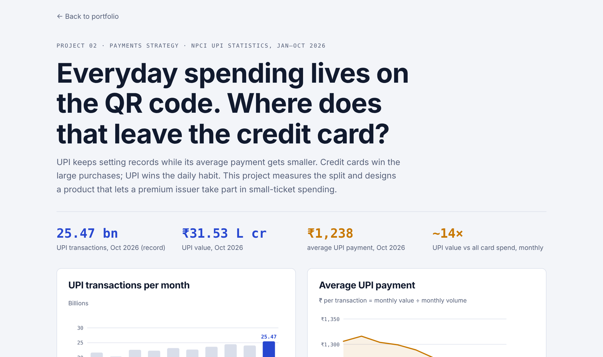

# UPI × Credit

**Everyday spending in India lives on the UPI QR code.** This project measures how far UPI has pulled away from credit cards and designs a "credit on QR" product for a premium card issuer.

[**Live dashboard**](https://abhinavspambox.github.io/projects/upi-credit/) · [Portfolio](https://abhinavspambox.github.io/) · [Dataset](https://github.com/abhinavspambox/india-payments-data)



## The signal

| Measure | Value |
| --- | --- |
| UPI transactions, Oct 2026 | 25.47 billion (record) |
| UPI value, Oct 2026 | ₹31.53 lakh crore |
| Average UPI payment, Jan → Oct 2026 | ₹1,306 → ₹1,238 |
| UPI value vs all card spend, each month Jan–Sep 2026 | 13.5× to 15.2× |

Only RuPay credit cards can be linked to UPI, and they already carry about 38% of credit card transactions by volume but about 8% by value (Bernstein, Oct 2025).

## The product

A **"credit on QR" companion** for a premium cardholder: a virtual RuPay credit card on the same credit limit, capped rewards on small QR payments, one statement, and customer-set spend caps.

**North star:** monthly active days across both cards. **Guardrails:** reward cost per transaction, fraud loss rate, delinquency.

## Riskiest assumption

Do premium cardholders want rewards on small QR payments at all? Planned test: 8 interviews plus a fake-door "Link to UPI" button that counts taps. *Status: not yet run.*

## Run it

```bash
python analysis.py        # reads data.csv and card_monthly.csv
```

---

Part of [Abhinav Kumar Tarkar's product portfolio](https://abhinavspambox.github.io/). Figures are compiled from public RBI and NPCI releases as reported in the press; every row links to its source. Product proposals are my own and do not reflect any employer's plans.
